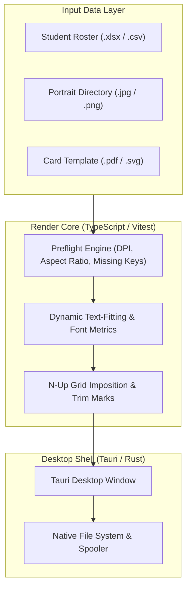

# ID Card Maker

**High-precision desktop layout and print-imposition engine built with Tauri, Rust, and TypeScript.**

ID Card Maker is a specialized desktop tool designed to process batches of institutional identity cards from spreadsheets and portrait directories. It handles aspect-ratio normalization, preflight quality checks, and automated N-up grid imposition for direct print runs.

---

## Key Features

- **Desktop-Native Performance:** Powered by Tauri v2 with a Rust backend for instant file I/O and low memory footprint.
- **Automated Print Imposition:** Calculates precise trim boxes, bleed margins, and grid alignments for multi-card press sheets.
- **Strict Preflight Validation:** Flags missing student records, corrupted portrait files, low-DPI imagery, and font-metrics mismatches before print.
- **Dynamic Text Fitting:** Mathematical bounding-box fitting algorithms ensure multi-line names and roles fit badges without truncation or clipping.
- **100% Client-Side:** Processes confidential student and corporate data completely locally with zero cloud dependencies.

---

## System Architecture



---

## Tech Stack

- **Desktop Framework:** [Tauri](https://tauri.app/) (Rust + Webview)
- **Frontend / UI:** React 19, TypeScript, Vite, TailwindCSS
- **Testing:** Vitest (14 automated test suites covering geometry, imposition, and preflight)
- **Mathematics & Layout:** Custom SVG/Canvas layout engine

---

## Project Structure

```
id-card-maker/
├── app/                  # Tauri desktop application
│   ├── src/              # React frontend & UI components
│   ├── src-tauri/        # Rust native backend & capabilities
│   └── test/             # App-level integration tests
├── src/                  # Core geometry & imposition engine
│   ├── card.ts           # Card definition and coordinate systems
│   ├── impose.ts         # Grid calculation and imposition logic
│   ├── preflight.ts      # Data validation and error reporting
│   └── text-fit.ts       # Mathematical font bounding & scaling
├── test/                 # Engine unit test suites (Vitest)
└── docs/superpowers/     # Specifications and architecture plans
```

---

## Getting Started

### Prerequisites

- Node.js 20+
- Rust toolchain (`cargo`, `rustc`)

### Installation

```bash
# Clone the repository
git clone https://github.com/ReaperOAK/id-card-maker.git
cd id-card-maker

# Install root engine dependencies
npm install

# Install desktop app dependencies
cd app && npm install && cd ..
```

### Running Tests

```bash
# Run core geometry & layout tests
npm test

# Run with coverage report
npm run test:coverage
```

### Launching Desktop Dev Mode

```bash
cd app
npm run tauri dev
```

---

## Engineering Design & Specifications

Complete technical specifications and development plans are preserved in:
- [Design Spec](docs/superpowers/specs/2026-09-01-id-card-maker-design.md)
- [Render Core Plan](docs/superpowers/plans/2026-09-01-render-core.md)
- [Desktop Editor Plan](docs/superpowers/plans/2026-09-03-desktop-editor.md)

---

## Author & License

- **Author:** [Owais Ahmed Khan (ReaperOAK)](https://github.com/ReaperOAK)
- **Portfolio:** [portfolio.owaiskhan.website](https://portfolio.owaiskhan.website)
- **License:** Proprietary / All rights reserved
